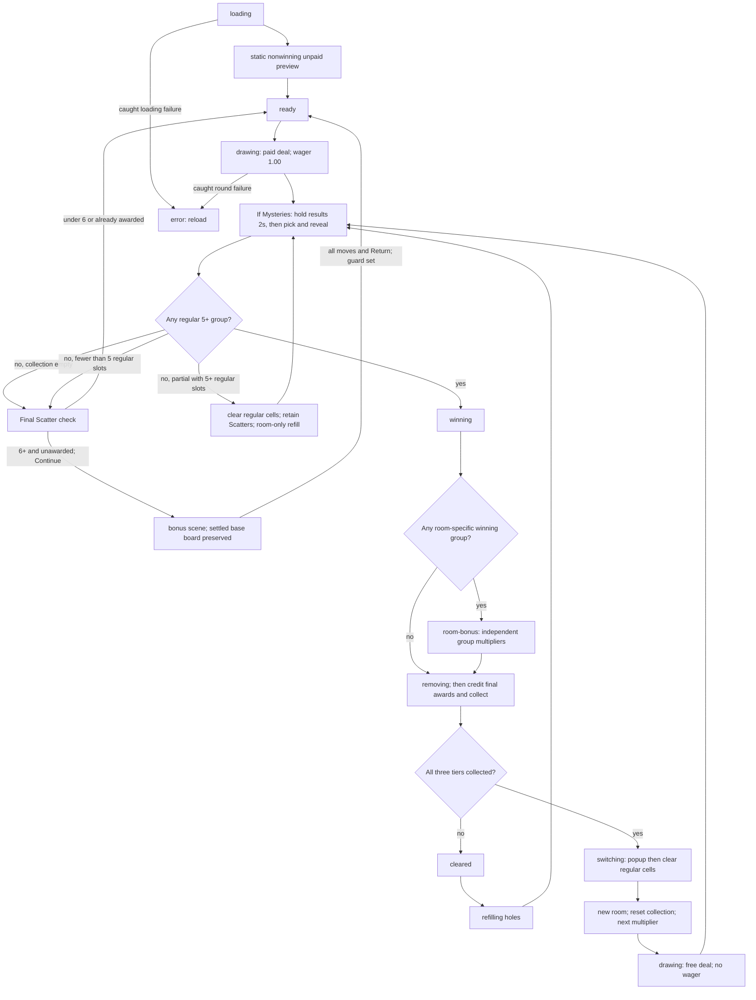

# 02 — Round flow and state transitions

**Context packet:** 25 independent cells; regular groups of 5+ pay once by count at the active multiplier. One 1.00 wager covers the whole chain, including refills, free stages and Scatter door adventures. Continue hands control to bonus gameplay; Return after all moves restores the settled board, with no base awards pending. See [08](08-scatter-bonus.md) and [10](10-door-adventure.md).

**Authority:** [src/main.ts](../../src/main.ts): startup statements, `start`, `requestRound`, canvas listeners, `setGameState`, `playPhase`, `resolveRound`.

## Vocabulary

| Term | Meaning in this document |
| --- | --- |
| Paid round / round chain | One accepted player start plus every refill and free stage resulting from it. Unit for Round win and paid-wager analysis. |
| Deal / counted spin | Fresh 25-cell board at the start of a paid round or free stage. |
| Evaluation | Find all qualifying regular identities on one board. |
| Refill | Replace only removed cells in the same stage; not a counted spin. |
| Stage | One background/index, collection set, and multiplier, lasting through its refills. |
| Preview | Initial unpaid 25-cell display; not an evaluated round. |

## Startup and input branches

| ID | Condition | Outcome |
| --- | --- | --- |
| F01 | Application initializes successfully | State `loading`; counters/wager/wins zero; empty collection; multiplier x1; popup/bonus scene hidden. Load five room images, bonus background, frame, title, three regular sheets, and Scatter (12 images total). |
| F02 | All artwork loads | Select one of five rooms uniformly, apply its collection, display a fixed 25-cell regular-only nonwinning preview (`createPreviewBoard`), then become `ready` immediately. Each identity occurs at most twice; no Scatter/Mystery, growth, board RNG, resolution, award or collection. Wait for the first accepted tap/Enter/Space before drawing paid results. |
| F03 | Click/request while state is not `ready`, or scene assets are absent | Discard the request. No wager, new board, counter change, or queued spin. |
| F04 | Key other than Enter or Space | Ignore it. No game action and no special prevention by this listener. |
| F05 | Enter/Space is an auto-repeat keydown | Prevent default but ignore the repeat. The initial nonrepeat keydown follows the ordinary request guard. Canvas must receive the keyboard event; it is focusable with Tab. |
| F06 | Click, Enter, or Space accepted while `ready` with assets | Immediately enter `drawing` / “Preparing the next round…”. This synchronous lock prevents another input from starting a parallel chain. A double-click can only add a further round if the previous chain has already finished. |
| F07 | Accepted paid round continues | Execute the ordered paid-start mutations below, animate the full deal, then evaluate it. |

### Exact paid-start mutation order

1. Set free-respin number to 0 and badge/multiplier to x1.
2. Choose another room uniformly from the four other rooms and apply it, resetting collection.
3. Reset the paid-chain Scatter award guard, then generate a fresh 25-cell board and discard the previous board, including Scatters.
4. Increment Spins by 1 and cumulative wager by 100 cents.
5. Reset Round win to 0; retain Session win and earlier paid wagers/spins.
6. Refresh visible statistics; mark all cells as growing.
7. Animate `drawing` / “Drawing symbols…”; then enter resolution, starting with a 500 ms raw-results pause if Mysteries landed, then the shared Mystery picker/reveal.

There is no balance check or affordability branch; this prototype has no bankroll.

## Resolution branches and priority

First hold results for 500 ms when Mysteries exist (T11), then reveal pending Mysteries through T03–T07 before every regular evaluation; Scatter entry is checked only at final chain settlement. This includes paid/free deals and refills. Preview has no Mysteries and runs no sequence.

| ID | Condition at this point | Outcome |
| --- | --- | --- |
| F08 | Evaluation finds zero winning groups and collection is empty | Check final Scatter eligibility through F17, then exit normally or hand off to the bonus. No extra wager/clear. Partial collection follows F19 instead. |
| F09 | Evaluation finds at least one group | Mark all winning positions and show the stage-adjusted base sum in `winning`. Then apply room multipliers once to this batch. If eligible, take F16 before `removing`; otherwise remove directly. Input remains locked. |
| F10 | Removal animation finishes | Remove all winning positions, update collection from those groups, clear winning highlights, add the computed award once to both Session win and Round win, and refresh stats/collection text. This is the award commit point. |
| F11 | Collection is still incomplete after F10 | Refill only holes, preserving survivors. Any collected tier activates current-room regular indexes; otherwise global pool. Scatter is3%. Animate replacements and re-evaluate; no wager/spin increment. |
| F12 | Refilled board has a further win / no further win | Further win repeats F09–F11/F13. No further win follows F08 (empty collection) or F19 (partial). Survivors can join later wins. There is no configured maximum refill count. |
| F13 | Collection is complete after F10 | Take the free-stage path in [03](03-stages.md). Retain Scatters in place, clear regular cells, change rooms, refill non-Scatter slots globally and evaluate at the new multiplier. Keep the paid-chain bonus guard. |
| F14 | Internal `while (assets)` guard has no assets | Resolution exits. Normal initialized gameplay never clears `assets`; this is an internal guard, not a player-facing exit or cash-out. Other asset-dependent helpers also no-op without assets. |
| F15 | Page reload/navigation recreates application | Abandon the in-memory chain and start again from F01. No saved round, restored collection, retained totals, refund process, or replay is implemented. |
| F16 | At least one winning group matches the room | After initial winning highlight, reveal each group's independent room multiplier and before/after award in `room-bonus` for 1100 ms. Highlight its cells in teal. Hide/clear this overlay, then remove all winners and credit the final sum (boosted and nonboosted groups together) once at F10. |
| F17 | No regular wins and no further room continuation (empty collection, or partial collection with fewer than five non-Scatter slots) | Only now check the final accumulated Scatters. If unawarded and 6+, bank their exact count and await Continue; otherwise settle. All Mystery reveals, regular awards, refills, room extra clears and collection-triggered floors have priority. Reset eligibility only on a new paid start. Preview never checks. |
| F18 | Completed bonus Return is accepted | Clear the move bank/badge, restore base accessibility and re-evaluate the same settled board with the paid-chain Scatter guard set. No base win/refill/floor remains; become ready without another popup. No extra wager or second pot credit. |
| F19 | No wins but partial collection | With at least five non-Scatter slots, clear regular cells, preserve Scatters/room/progress/multiplier/bonus guard, refill through the room pool and re-evaluate. With fewer than five regular slots, settle after any eligible bonus; do not loop or discard Scatters. |

**Priority is important:** all simultaneous winners are paid before checking stage completion. A completion discards regular survivors after the popup while retaining Scatter cells; it does not award anything merely for clearing those survivors.

## Settled result

When resolution returns without a bonus handoff, clear the growing-cell set, refresh the accessible board description, enter `ready`, and display:

```text
Won {round_win_with_two_decimals} · Tap or click · Bet 1.00
```

The final board, background, multiplier and totals remain visible, with empty collection, or partial collection when protected Scatters leave fewer than five regular slots. Other partial collection follows F19. The next paid start resets as specified above. The settled board contains no regular 5+ identity; any number of Scatters may remain (subject to the paid chain's bonus-entry guard).

If saved bonus moves are nonzero, append ` · Bonus: {N} moves saved` to the settled message and retain the reel badge. Normal play completes all banked moves before paid-ready. The next paid start begins with an empty bank and fresh bonus eligibility.

## State graph



The controller has no explicit `evaluating` state; evaluation runs synchronously between animated states. The graph's caught-round-error edge applies to caught failures anywhere within the awaited round chain, not just its initial draw. Runtime caveats are in [05](05-runtime-ui.md).
