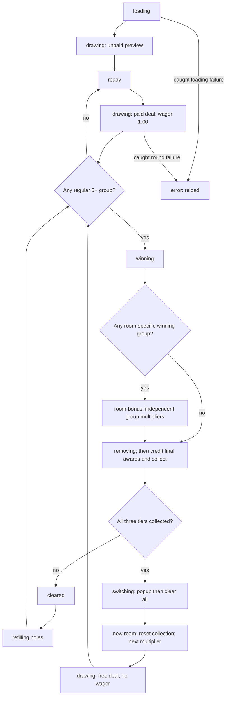

# 02 — Round flow and state transitions

**Context packet:** 25 independent cells; regular groups of 5+ pay once by count at the active multiplier. One 1.00 wager starts a complete round chain. Refills and collection-driven free stages are automatic and free. Scatter has no active feature.

**Authority:** [src/main.ts](../../src/main.ts): startup statements, `start`, `requestRound`, canvas listeners, `setGameState`, `playPhase`, `resolveRound`.

## Vocabulary

| Term | Meaning in this document |
| --- | --- |
| Paid round / round chain | One accepted player start plus every refill and free stage resulting from it. Unit for Round win and paid-wager analysis. |
| Deal / counted spin | Fresh 25-cell board at the start of a paid round or free stage. |
| Evaluation | Find all qualifying regular identities on one board. |
| Refill | Replace only removed cells in the same stage; not a counted spin. |
| Stage | One background/index, collection set, and multiplier, lasting through its refills. |
| Preview | Initial unpaid 25-cell display; not an evaluated round. |

## Startup and input branches

| ID | Condition | Outcome |
| --- | --- | --- |
| F01 | Application initializes successfully | State `loading`; counters/wager/wins zero; empty collection; multiplier x1; popup hidden. Load all five room images, frame, title, three regular sheets, and Scatter (11 images total). |
| F02 | All artwork loads | Select one of five rooms uniformly, apply its collection, generate and animate a 25-cell preview, then become `ready`. Do not call win resolution. Even a preview containing 5+ matches earns nothing and collects nothing. |
| F03 | Click/request while state is not `ready`, or scene assets are absent | Discard the request. No wager, new board, counter change, or queued spin. |
| F04 | Key other than Enter or Space | Ignore it. No game action and no special prevention by this listener. |
| F05 | Enter/Space is an auto-repeat keydown | Prevent default but ignore the repeat. The initial nonrepeat keydown follows the ordinary request guard. Canvas must receive the keyboard event; it is focusable with Tab. |
| F06 | Click, Enter, or Space accepted while `ready` with assets | Immediately enter `drawing` / “Preparing the next round…”. This synchronous lock prevents another input from starting a parallel chain. A double-click can only add a further round if the previous chain has already finished. |
| F07 | Accepted paid round continues | Execute the ordered paid-start mutations below, animate the full deal, then evaluate it. |

### Exact paid-start mutation order

1. Set free-respin number to 0 and badge/multiplier to x1.
2. Choose another room uniformly from the four other rooms and apply it, resetting collection.
3. Generate a fresh 25-cell board; discard the previous board.
4. Increment Spins by 1 and cumulative wager by 100 cents.
5. Reset Round win to 0; retain Session win and earlier paid wagers/spins.
6. Refresh visible statistics; mark all cells as growing.
7. Animate `drawing` / “Drawing symbols…”; then enter resolution.

There is no balance check or affordability branch; this prototype has no bankroll.

## Resolution branches and priority

| ID | Condition at this point | Outcome |
| --- | --- | --- |
| F08 | Evaluation finds zero winning groups | Exit resolution immediately. No removal, refill, collection check, stage bonus, or extra wager. Settle as ready, even if Round win is zero. |
| F09 | Evaluation finds at least one group | Mark all winning positions and show the stage-adjusted base sum in `winning`. Then apply room multipliers once to this batch. If eligible, take F16 before `removing`; otherwise remove directly. Input remains locked. |
| F10 | Removal animation finishes | Remove all winning positions, update collection from those groups, clear winning highlights, add the computed award once to both Session win and Round win, and refresh stats/collection text. This is the award commit point. |
| F11 | Collection is still incomplete after F10 | Briefly display holes in `cleared`; identify holes, refill only those positions, animate just the replacements in `refilling`, then loop back to evaluation. No wager/spin increment. |
| F12 | Refilled board has a further win / no further win | Further win repeats F09–F11/F13. No further win follows F08. Existing symbols can participate in later winning groups. There is no configured maximum number of refills. |
| F13 | Collection is complete after F10 | Take the free-stage path in [03](03-stages.md), instead of F11. Do not refill the old stage. After the new full deal, return to evaluation with the new multiplier. |
| F14 | Internal `while (assets)` guard has no assets | Resolution exits. Normal initialized gameplay never clears `assets`; this is an internal guard, not a player-facing exit or cash-out. Other asset-dependent helpers also no-op without assets. |
| F15 | Page reload/navigation recreates application | Abandon the in-memory chain and start again from F01. No saved round, restored collection, retained totals, refund process, or replay is implemented. |
| F16 | At least one winning group matches the room | After initial winning highlight, reveal each group's independent room multiplier and before/after award in `room-bonus` for 1100 ms. Highlight its cells in teal. Hide/clear this overlay, then remove all winners and credit the final sum (boosted and nonboosted groups together) once at F10. |

**Priority is important:** all simultaneous winners are paid before checking stage completion. A completion discards every survivor and Scatter from the old stage after the popup; it does not award anything merely for clearing those survivors.

## Settled result

After resolution returns normally, clear the growing-cell set, refresh the accessible board description, enter `ready`, and display:

```text
Won {round_win_with_two_decimals} · Tap or click · Bet 1.00
```

The final board, last background, last multiplier, partial collection, and totals remain visible. They are replaced/reset as specified by the next accepted paid start. The final evaluated board contains no regular identity five or more times; any number of Scatters may remain.

## State graph



The controller has no explicit `evaluating` state; evaluation runs synchronously between animated states. The graph's caught-round-error edge applies to caught failures anywhere within the awaited round chain, not just its initial draw. Runtime caveats are in [05](05-runtime-ui.md).
